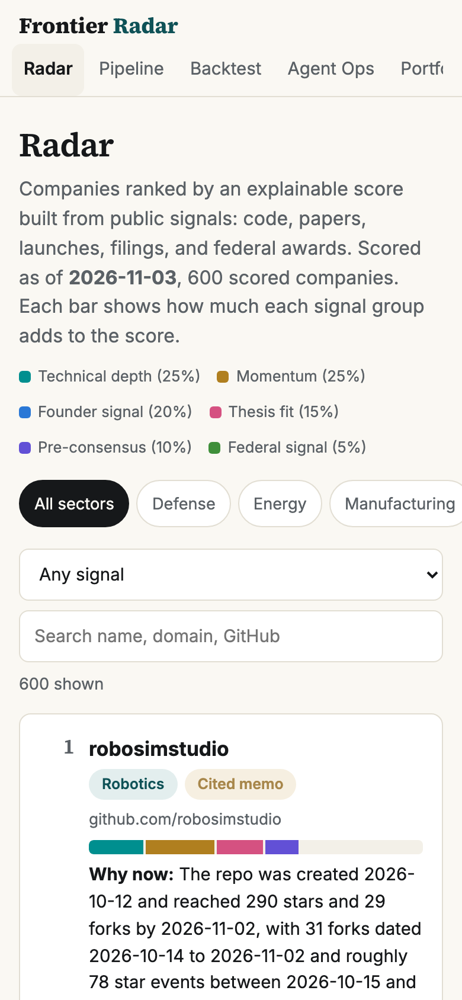
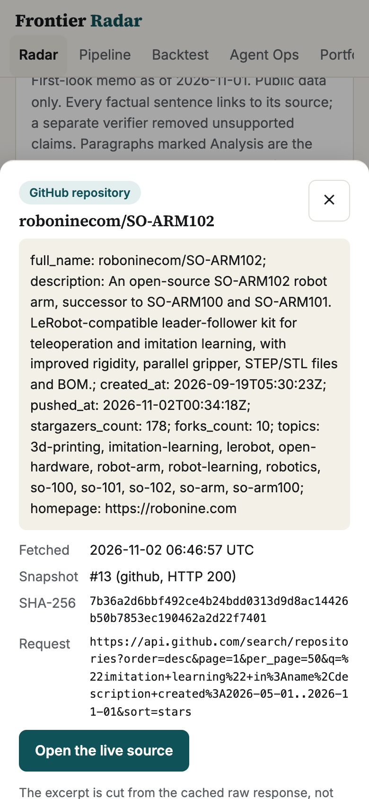
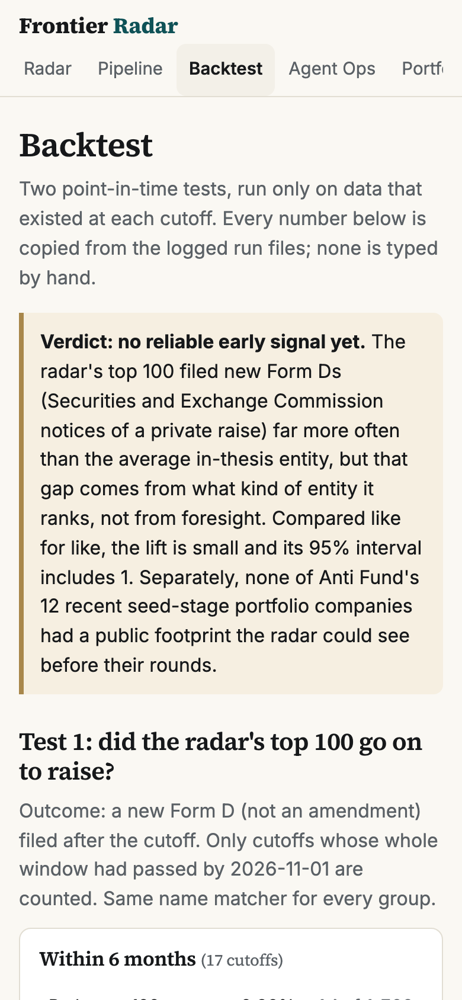

# Frontier Radar

A sourcing system for frontier technology (robotics, defense, energy, space, manufacturing,
semiconductors). It reads public code, papers, launches, SEC filings, and federal awards, plus
private relationship notes; resolves them into companies and founders; ranks them with an
explainable score; and writes first-look memos in which every factual sentence is cited and
checked by a separate verifier agent.

**Dashboard:** https://frontier-radar-eight.vercel.app (access code on request) ·
**Built by** Mohamed El Askary for the Anti Fund MTS (Member of Technical Staff) / Associate application.

<p>



</p>

## 1. The honest finding

**Public data did not find Anti Fund's seed-stage frontier companies early.** Using only data
that existed before each round was announced, the radar collected 211,064 repositories, 662
launch posts, 959 papers, and 1,712 federal awards from thesis queries (never by company name;
the query audit passed). **0 of 12** portfolio companies appeared at any cutoff: they left no
public trace before their rounds. Their first repositories and launch posts came on or after
announcement day.

**A broader test: do the radar's top 100 go on to raise?** Against 166,070 SEC Form D filings:

| Window | Radar top 100 | Stars top 100 | In-thesis universe | Raw lift | Like for like (same entity type) |
|---|---|---|---|---|---|
| 6 months | 0.82% | 0.00% | 0.021% | 39.2x (95% CI 0 to 126) | **1.65x (0 to 3.85)** |
| 12 months | 1.11% | 0.00% | 0.048% | 23.1x (0 to 92) | **1.13x (0 to 2.96)** |

The raw lift is misleading: the radar's top 100 is mostly real organizations, while the
universe is 92% individual GitHub accounts that never file Form Ds. Like for like, the
intervals include 1 and every hit comes from three companies. **It does not hold up.** What
it does show is narrower: the top of the list is real companies, not hobby accounts.

The signals that come before a seed round are relational: founder intros, lab relationships,
conference conversations, private hiring data. That is what section 2 is built for.
Full detail: [docs/backtest-report.md](docs/backtest-report.md).

## 2. What it does well, and what it is for

Turning any source, public or private, into cited, verifier-checked memos.

- **Private signals intake.** Warm intros, lab relationships, conference notes, and hiring
  notes go in through a dashboard form, `radar signal add`, or a CSV import. Each is matched
  to a company exactly (domain, GitHub organization, or distinctive name), stored with a hashed
  snapshot, and cited in memos like any public source. Private notes never leave the local
  database.
- **Memos you can audit.** A research agent drafts; a verifier that sees only each claim and
  its cited excerpts keeps, rewrites, or removes it. Judgment sits in paragraphs marked
  Analysis (the hard technical problem, what changed recently, how it could fail), and any
  number used there must also appear in a cited fact. Every citation opens the cached source
  with its fetch time and SHA-256 hash.
- **Founders from their own sites.** Home, About, Team, and Careers pages (robots.txt obeyed)
  so memos can name founders and backgrounds with citations.
- **Explainable ranking** across six signal groups, with university labs and large companies
  filtered out using names, domains, and GitHub profiles.
- **Portfolio Stats** for 34 Anti Fund companies from public proxies, with a cited
  quarterly-style update draft. Public data only.

| Eval gate | Result | Target |
|---|---|---|
| Claim citation precision (40 human-checked claims) | 1.00 | 0.95 |
| Thesis classifier, shipped path | 0.900 | 0.85 |
| Entity resolution precision (in-sample) | 0.984 | 0.90 |
| Leakage test | Pass | Pass |
| LLM (large language model) spend to date | about $1 | under $15 |

The claim gate measures citation accuracy, not the quality of the analysis. The backtest uses
the classifier alone (no LLM) so a model's knowledge of later outcomes cannot leak in.

## 3. Live Picks

Today's top companies on the radar with **no SEC Form D on file**, as a dated, falsifiable bet.
**Picked 2026-11-03, graded 2027-05-04:** a hit if the company files a new Form D or a priced
round is publicly reported by then; the grade is published either way. Each pick has a live
company website; university groups, large companies, and off-thesis projects were removed and
logged with reasons in [picks/exclusions.csv](picks/exclusions.csv).

| # | Company | Rank | Why it is on the list |
|---|---|---|---|
| 1 | [Roboparty](https://roboparty.com) | 3 | Humanoid control code (343 stars) and a new dexterous-hand hardware repo |
| 2 | [Robonine](https://robonine.com) | 6 | Open SO-ARM102 robot-arm kit at $389; its site says the first batch ships in late October |
| 3 | [openAMRobot](https://docs.openamrobot.ai) | 8 | Open mobile-robot platform, software and hardware; 65 pull requests, mostly from outside contributors |
| 4 | [Hakoniwa Lab](https://hakoniwa-lab.net) | 12 | Japanese LLC shipping a ROS 2 robot runtime and RISC-V flight firmware |
| 5 | [Hebbian Robotics](https://hebbianrobotics.com) | 19 | **YC-backed (S26)** ([source](https://news.ycombinator.com/item?id=49510632)); open-source robotics data SDK, 305 stars and 168 forks |
| 6 | [FactorySemantics](https://factorysemantics.com) | 27 | Open-source factory execution software; 217 outside pull requests, no live plant yet |
| 7 | [Voight](https://voight.xyz) | 33 | Observability for AI agents, extending to drones through a MAVLink bridge |
| 8 | [Vyges](https://vyges.com) | 36 | Chip-design IP and open EDA tools; claims a taped-out Sky130 sensor chip |

We stopped at 8: after the exclusions, candidates below rank 40 no longer met the
company-evidence and traction bar. Full why-now lines with dates: [picks/2026-11-03.md](picks/2026-11-03.md).

## Run it

```bash
make setup && cp .env.example .env          # Python 3.12 via uv; add ANTHROPIC_API_KEY, SEC_USER_AGENT
uv run radar collect github --since 2026-10-01
uv run radar score                          # resolve, enrich, score, why-now lines, memos
uv run radar picks                          # Live Picks
uv run radar export && make web-dev         # dashboard at http://localhost:3000
make ci                                     # lint, types, tests, no-em-dash check
```

Reading order: this README, [docs/backtest-report.md](docs/backtest-report.md),
[docs/09-change-log.md](docs/09-change-log.md) (every run and fix, including the failures),
[BUILD_CONTRACT.md](BUILD_CONTRACT.md), then `radar/agents/` and its versioned prompts.

## Next

- Weekly GitHub Actions run (Mondays 13:00 UTC) with a Resend email digest
- ElevenLabs audio briefing (about 2 minutes) linked from the email and dashboard
- Shared backend (Neon Postgres) so pipeline moves, votes, and the Signals form persist on the hosted dashboard
- `make demo`: offline dashboard from a fresh clone with no keys
- Full documentation package (docs 00 to 08) and an architecture diagram
- An independent holdout set for entity resolution, and more thesis labels
- Grade Live Picks on 2027-05-04 and publish the result either way

---

Frontier Radar is an independent work sample by Mohamed El Askary, built for the Anti Fund MTS / Associate application. Not affiliated with Anti Fund.
