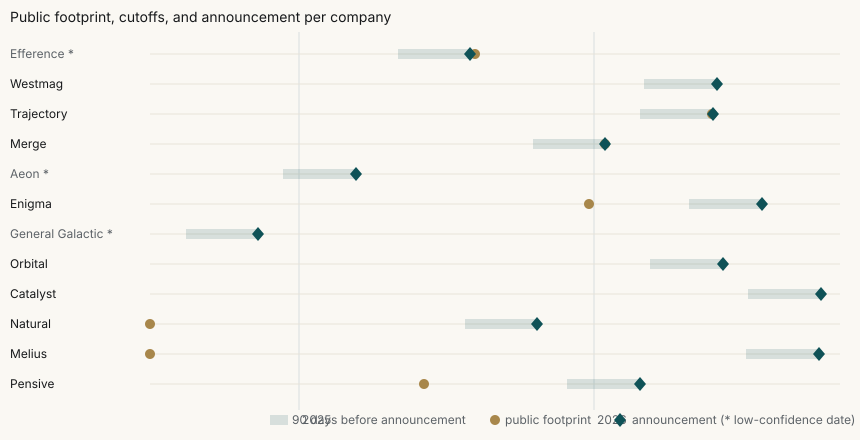

# Backtest Report

_Generated 2026-11-02 from `eval/backtest/results.json`. Every number below is computed; the analysis section is written by hand._

## Test 1: did the radar's top 100 go on to raise?

Outcome: a new Form D (not an amendment) filed within 6 or 12 months after the cutoff. Only cutoffs whose window had fully passed by 2026-11-01 count. Matching: exact normalized name or GitHub org vs Form D issuer, distinctive names only. Intervals are 95% bootstrap intervals that resample companies, because a company recurs across cutoffs.

| Window | Cutoffs | Radar top 100 | Stars top 100 | In-thesis universe | Raw lift | Lift vs same entity type | Companies with a hit |
|---|---|---|---|---|---|---|---|
| 6m | 17 | 0.82% (14 of 1,700) | 0.00% (0 of 1,700) | 0.021% (42 of 197,093) | 39.2x (0.00 to 126.45) | 1.65x (0.00 to 3.85) | 3 |
| 12m | 9 | 1.11% (10 of 900) | 0.00% (0 of 900) | 0.048% (34 of 70,492) | 23.1x (0.00 to 92.03) | 1.13x (0.00 to 2.96) | 2 |

Sensitivities (excluding companies with any Form D before the cutoff; only matchable names) are in `eval/backtest/formd_results.json`. Every matched filing is listed in `eval/backtest/formd_matches.csv`.

## Test 2: Anti Fund's portfolio

Using only data available before each round was publicly announced, would Frontier Radar have ranked Anti Fund's early-stage frontier investments highly?

| Set | Companies | Offset | In universe | Passed thesis gate | Recall@25 | Recall@100 | Stars baseline recall@100 | Random recall@100 | Median candidates |
|---|---|---|---|---|---|---|---|---|---|
| Primary (frontier) | 5 | T minus 90 | 0 | 0 | 0.0% | 0.0% | 0.0% | 0.7% | 16,119 |
| Primary (frontier) | 5 | T minus 30 | 0 | 0 | 0.0% | 0.0% | 0.0% | 0.5% | 20,120 |
| Secondary (applied AI) | 4 | T minus 90 | 0 | 0 | 0.0% | 0.0% | 0.0% | 0.7% | 18,483 |
| Secondary (applied AI) | 4 | T minus 30 | 0 | 0 | 0.0% | 0.0% | 0.0% | 0.6% | 23,061 |
| Sensitivity (low-confidence dates) | 3 | T minus 90 | 0 | 0 | 0.0% | 0.0% | 0.0% | 1.5% | 6,584 |
| Sensitivity (low-confidence dates) | 3 | T minus 30 | 0 | 0 | 0.0% | 0.0% | 0.0% | 1.4% | 6,899 |

Primary companies found in the top 100 at any cutoff: 0 of 5. Median lead time: n/a.

## Per company

| Company | Set | Announced | Date confidence | Verified public footprint before T | T minus 90 | T minus 30 | Stars baseline (T minus 30) |
|---|---|---|---|---|---|---|---|
| Efference | primary | 2025-08-01 | low | none found | not found | not found | not in universe |
| Westmag | primary | 2026-06-02 | high | none found | not found | not found | not in universe |
| Trajectory | primary | 2026-05-28 | medium | first Hacker News link to domain 2026-05-27 | not found | not found | not in universe |
| Merge | primary | 2026-01-15 | high | none found | not found | not found | not in universe |
| Aeon | primary | 2025-03-13 | low | none found | not found | not found | not in universe |
| Enigma | primary | 2026-07-27 | high | first Hacker News link to domain 2025-12-26 | not found | not found | not in universe |
| General Galactic | primary | 2024-11-12 | low | none found | not found | not found | not in universe |
| Orbital | primary | 2026-06-09 | high | none found | not found | not found | not in universe |
| Catalyst | secondary | 2026-10-08 | high | none found | not found | not found | not in universe |
| Natural | secondary | 2025-10-23 | high | first Hacker News link to domain 2019-12-03 | not found | not found | not in universe |
| Melius | secondary | 2026-10-06 | medium | first Hacker News link to domain 2011-12-14 | not found | not found | not in universe |
| Pensive | secondary | 2026-02-27 | high | first public repo (pensieve-ai) 2025-06-05 | not found | not found | not in universe |

## Leakage checks

- Query audit: 593 distinct discovery queries; queries naming a portfolio company: 0; companies with no discovery row: 0. Result: pass.
- `tests/test_leakage.py` fails CI if any portfolio name or domain appears in `radar/` or `config/`.
- Features read only rows timestamped on or before the cutoff; thesis text and prescore breadth are cut at the cutoff too. Features with no history (job boards, current citations, recent stars) are excluded in backtest mode.

## Protocol

- Cutoffs at T minus 90 and T minus 30 days, T = public announcement (sources in `eval/backtest/rounds.csv`).
- Universe: entities first seen within 365 days before the cutoff, from thesis queries only (GitHub search windows paged exhaustively, Hacker News launches, code-linked arXiv papers, USAspending awards).
- Prescore with hindsight-free signals, enrich the top 60, score the top 600.
- Baseline: total GitHub stars as fetched (hindsight-advantaged; BUILD_CONTRACT D5).
- Rows with low-confidence dates are reported separately and excluded from the headline.
- Runtime: 117 minutes.

## Eval gates at the time of this report

| Gate | Value | Target | Status |
|---|---|---|---|
| claim citation precision | None | >= 0.95 supported (published claims, human spot-check of 40) | pending |
| thesis classifier accuracy | 0.9 | >= 0.85 | pass |
| entity resolution precision | 0.984 | >= 0.90 precision | pass |
| leakage test | pass | pass | pass |
| total llm cost | 0.3094 | < $15.00 | pass |
| weekly pipeline minutes | None | < 20 | pending |
| offline demo | None | make demo on a fresh clone, no keys | pending |

## Analysis

### Test 1: Form D outcomes

The raw comparison looks dramatic and is misleading. The radar's top 100 went on to file new
Form Ds about 39 times as often as the average in-thesis entity over 6 months, and about 23
times as often over 12 months. But the radar's top 100 is mostly organizations and federal
awardees, while the in-thesis universe is 92% individual GitHub accounts, which almost never
file Form Ds. Compared like for like, each radar entry against the in-thesis rate of its own
entity type at the same cutoff, the lift is about 1.65 at 6 months and 1.13 at 12 months, and
both 95% intervals include 1. Every hit comes from two or three companies that recur across
cutoffs. The GitHub-stars baseline had no hits at all.

So this test does not show that the radar predicts raises. It shows something narrower and
real: the radar's top of list is made of actual companies rather than hobby accounts, which is
the precondition for being useful, not proof of foresight. The like-for-like control was added
after seeing the composition imbalance, and it is reported next to the raw figure rather than
in place of it.

### Test 2: Anti Fund's portfolio

Frontier Radar found none of the twelve companies before their rounds were announced. That is
not a ranking failure. None of the twelve appears anywhere in the collection: not in the
universe at either cutoff, not below the thesis gate, not outside the lookback window. The
radar never saw them, so it never had the chance to rank them.

The footprint check explains why. Before each company's T minus 30 cutoff, the public
technical record that thesis queries can reach was empty for every included primary company:

- Efference's first public repository was created six days after its round was reported.
- Trajectory's and Merge's first launch posts appeared on announcement day.
- Enigma's only earlier trace is a handful of low-point links to its blog, which are neither a
  launch post nor a repository.
- General Galactic's GitHub account has no public repositories.
- Westmag, Orbital, Aeon, and Catalyst have no public technical footprint that we could find.
- Pensive, in the secondary applied-AI set, did have public repositories nine months before
  its round. They are outside the frontier thesis queries by design, so missing them is the
  thesis doing its job, not a bug.

The pattern is consistent with how frontier companies are actually funded at seed and
pre-seed: the round comes before the public artifacts, not after them. Anti Fund is often the
first or one of the first checks, which is exactly the regime where public signal is thinnest.

### What this backtest can and cannot claim

- **Small n.** Twelve companies, nine with reliable dates. A zero here bounds what public data
  can do for this portfolio at seed; it says little about later stages.
- **Survivorship and selection.** The test set is Anti Fund's own picks. Companies the firm
  passed on, and companies that never raised, are not in it, so this measures whether the radar
  would have found the firm's winners, not whether its top 25 would have made good investments.
- **Point-in-time gaps.** Stars at the cutoff, hiring history, and current citations are not
  observable historically (BUILD_CONTRACT D1, D5). Those features are switched off in backtest
  mode, so the backtest scores a weaker radar than the live one.
- **Thesis filter.** The backtest filters with the classifier alone, about 68% accurate on
  Mohamed's labels, because an LLM judge reading historical text could carry hindsight about
  which companies later became famous (BUILD_CONTRACT D9). The live radar adds the judge for
  uncertain cases and measures about 90%.
- **Leakage.** The query audit passed: no discovery query names a target company or domain, and
  every company in every universe traces to a thesis query. The zero is not an artifact of
  hiding the answer and is not inflated by finding it.

### What would close the gap

Public code, papers, and launches arrive after the round for this kind of company, so a
sourcing system that only reads them will always be late at seed. The signals that come first
are private or relational:

- **Founder network intros:** who is talking to whom before a company has a name, from the
  firm's own portfolio founders and operators.
- **University lab relationships:** which PhD students and postdocs in robotics, energy, and
  defense labs are about to leave, known through advisors and lab alumni before any
  repository exists.
- **Conference and event attendee lists:** small technical workshops, defense and energy
  industry days, and the firm's own events, where founders appear months before a launch post.
- **Private hiring data:** early recruiting conversations and stealth job descriptions, which
  move before public job boards.

Frontier Radar is built to take these as additional evidence types: each would be a new
collector writing timestamped rows with a source, scored by the same point-in-time features
and cited the same way in memos. The public layer still earns its place after the first check:
it tracks portfolio momentum, catches the later-stage company that ships in public, and makes
every claim in a memo traceable. But the honest result of this backtest is that, for Anti
Fund's seed-stage frontier picks, the edge is in relationships, and the software should be
built to capture and structure them.

---

Frontier Radar is an independent work sample by Mohamed El Askary, built for the Anti Fund MTS / Associate application. Not affiliated with Anti Fund.
